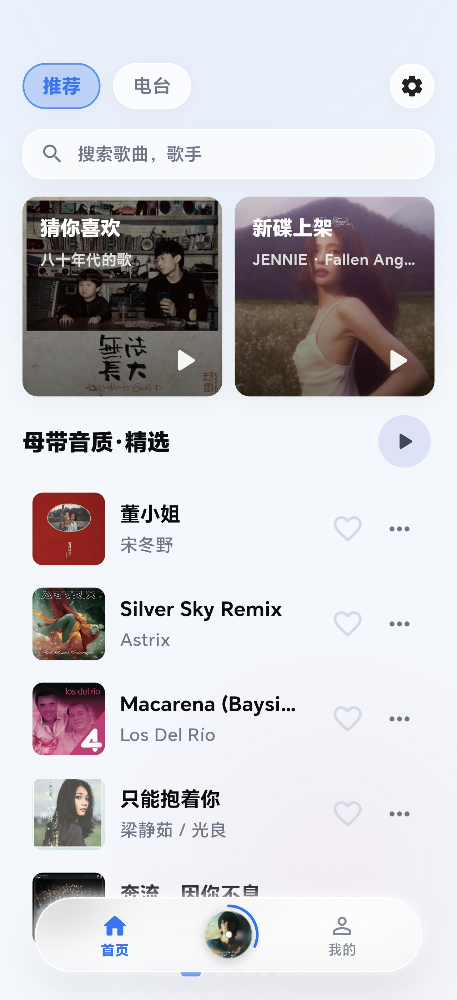
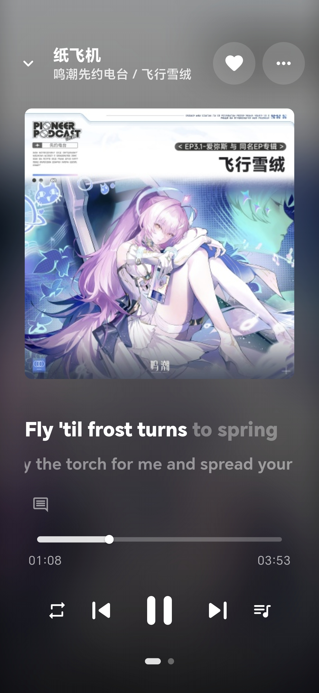
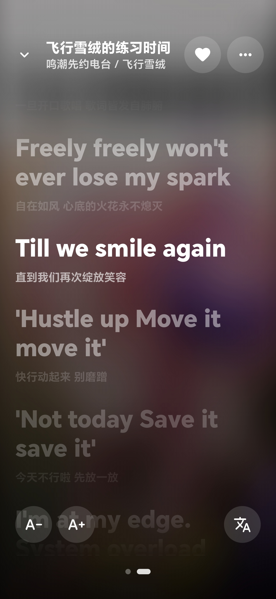
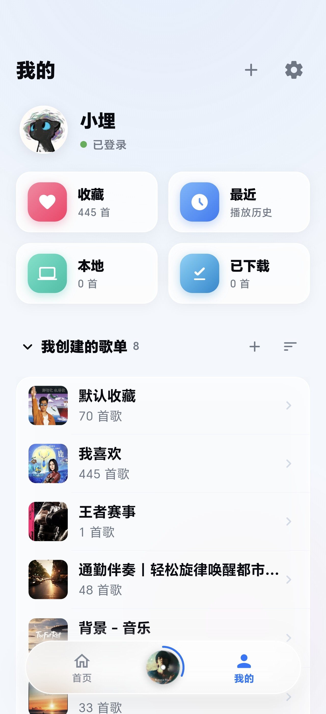
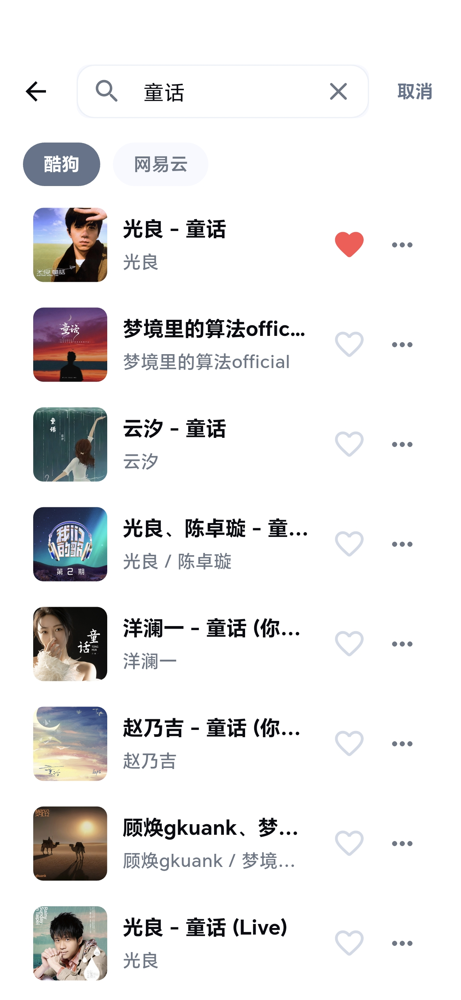
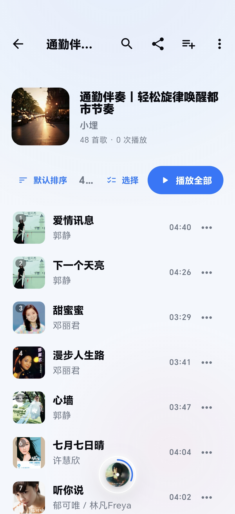

<p align="center">
  
</p>

<h1 align="center">Melos</h1>

<p align="center">
  <strong>自托管音乐 Web PWA · 一条 Docker 命令启动</strong>
  <br />
  Flutter 前端 · 内嵌 KuGouMusicApi · 扫码登录 · 浏览器/手机主屏直接听歌
</p>

<p align="center">
  
  
  
  
</p>

<p align="center">
  
  
  
  
</p>

---

## 📖 Melos 是什么

**Melos 是一个自托管的音乐 Web PWA。** 它把 Flutter 音乐客户端（基于
[KA Music](https://github.com/umr-xiaomai/kgka_Music_hl)）、酷狗 API
（KuGouMusicApi）和会话适配网关打包成一套 Docker Compose 服务。

部署后打开浏览器即可使用：用 **酷狗音乐概念版 App** 扫码登录一次，就能搜索、
播放、管理歌单、看歌词和评论；在 iPhone / Android 上「添加到主屏幕」后，
它就像一个原生音乐 App 一样运行。

### 为什么是 Melos

- **一条命令部署**：`docker compose -f docker-compose.web.yml up -d --build`。
- **不需要 VNC**：浏览器原生音频播放，不再通过网页桌面串流声音。
- **不需要 Flutter SDK**：前端已预编译在 `prebuilt/web`，服务器构建只做镜像打包。
- **登录态持久化**：会话保存在 `melos-web-data` 数据卷，重启/升级无需重新扫码。
- **同源代理**：音频、评论、头像都经由 `/api` 转发，避开 HTTPS 混合内容与 CORS。
- **iPhone 优化**：自动限制渲染倍率、关闭高开销模糊与旋转，输入框不再触发页面放大。
- **可选桌面版**：需要本地音乐、下载、桌面歌词时，可改用 Linux 桌面版部署。

> 本项目通过第三方 API 获取音乐数据，仅供学习交流。歌曲版权归原平台与版权方所有；
> VIP / 版权受限歌曲可能没有可用播放地址。

---

## 🚀 快速开始

### 环境要求

- Docker 24+，Docker Compose v2
- x86_64 Linux 主机
- 默认占用宿主机端口 **34962**

### 1. 启动

```bash
git clone https://github.com/Tomkmonkey/Melos.git
cd Melos
docker compose -f docker-compose.web.yml up -d --build
```

> 已经拿到本项目目录时，直接进入该目录执行最后一条命令即可。

打开 `http://<主机IP>:34962`。

### 2. 登录

1. 在登录页选择「扫码登录」。
2. 使用 **酷狗音乐概念版 App** 扫码并确认。
3. 登录态写入 `melos-web-data` 数据卷与浏览器 localStorage，下次打开自动恢复。

### 3. 安装为 PWA

- **iPhone / iPad**：Safari 打开 → 分享 → 「添加到主屏幕」。
- **Android**：Chrome 打开 → 菜单 → 「安装应用」/「添加到主屏幕」。
- **桌面浏览器**：Chrome / Edge 地址栏右侧的安装图标。

> 公网部署建议使用 HTTPS：Service Worker 与 PWA 安装要求安全上下文
>（`localhost` 除外）。可用 Caddy / Nginx / 反向代理自行配置证书。

### 常用命令

```bash
# 查看日志
docker compose -f docker-compose.web.yml logs -f

# 停止
docker compose -f docker-compose.web.yml down

# 停止并清空登录态 / 数据（不可恢复）
docker compose -f docker-compose.web.yml down -v

# 更换端口
MELOS_WEB_PORT=8080 docker compose -f docker-compose.web.yml up -d --build
```

---

## ✨ 功能亮点

> 以下为 Web PWA 中可用的功能。本地音乐、下载、桌面歌词等平台能力默认隐藏，
> 需要时请使用可选的 Linux 桌面版。

### 🎵 播放

- 标准 / 高品质 / 无损多音质切换，失败自动降级重试
- 列表循环 / 随机播放 / 单曲循环
- 0.5x ~ 3.0x 倍速播放
- 均衡器预设与低音增强
- 定时停止（按时间或播完当前歌曲）
- 播放队列、进度恢复、最近播放

### 🎤 歌词与评论

- KRC 逐字歌词、翻译、罗马音
- 双击歌词跳转进度、调整字号
- 热门 / 最新评论、楼层回复、评论配图
- 评论与头像经由同源代理加载，HTTPS 下也能正常显示

### 🔍 搜索与曲库

- 酷狗 + 网易云双源搜索、搜索联想、热搜与历史
- 每日推荐、推荐歌单、FM 电台
- 歌单创建 / 收藏 / 重命名 / 排序 / 批量删除
- 导入 QQ 音乐 / 网易云歌单，显示匹配与失败明细
- 收藏、云盘、专辑商店

#### 导入 QQ 音乐 / 网易云歌单

1. 在来源 App 中把歌单设为公开并复制分享链接（或整段分享文本）。
2. 打开 Melos 的「我的 → 导入 QQ / 网易云歌单」，粘贴后点击「解析歌单」。
3. 确认名称与数量，选择新建歌单或已有歌单，点击「开始导入」。
4. 导入完成后可查看新增、已存在、未匹配与失败数量；支持停止和重试。

### 🎨 个性化与数据

- Material You 动态取色、深色模式、自定义背景
- 播放历史、听歌时长、最常听歌手 / 歌曲 Top 10
- PWA 独立窗口、离线壳与图标

---

## 📸 界面预览

| 首页 | 播放器 | 歌词 |
|:----:|:------:|:----:|
|  |  |  |

| 我的 | 搜索 | 歌单 |
|:----:|:----:|:----:|
|  |  |  |

---

## 🏗️ 架构与实现

```
浏览器 / PWA
      │  http(s)://<host>:34962
      ▼
┌───────────────────────────────────────────────────┐
│ Docker 项目 melos-web                             │
│                                                   │
│  melos-web (Nginx)                               │
│    ├── /            → prebuilt/web 静态文件       │
│    └── /api/        → melos-api:3005              │
│                                                   │
│  melos-api (Node 18)                              │
│    ├── 会话网关 server.js                          │
│    │     ├── /audio-proxy    音频 Range 转发       │
│    │     ├── /comment-proxy  评论转发              │
│    │     └── 登录 / 会话协议适配                   │
│    └── KuGouMusicApi :3006 (platform=lite)        │
└───────────────────────────────────────────────────┘
```

### 组成

| 组件 | 说明 |
|---|---|
| `melos-web` | Nginx + 预编译 Flutter Web，默认端口 80（宿主机 34962） |
| `melos-api` | Node 18，内置会话网关与 KuGouMusicApi |
| `melos-web-data` | 登录会话、网关数据持久化卷 |
| `prebuilt/web` | 已构建的前端产物，部署时不需要 Flutter SDK |

### 关键设计

- **会话网关**：客户端只认 `X-Kg-Session-Id` / `t1` 头，网关转换成酷狗 Cookie；
  扫码登录、刷新、退出都由网关适配。
- **同源代理**：音频与评论接口多为 HTTP 且不带 CORS 头，直接请求会被浏览器拦截；
  `/api/audio-proxy` 与 `/api/comment-proxy` 在服务端转发，并严格限制目标域名。
- **Range 透传**：音频代理完整转发 `Range` / `206`，支持拖动进度。
- **预编译产物**：Web 与 Linux 前端都在开发机编译，部署机只负责打包镜像。
- **网页切歌补丁**：内置 `third_party/just_audio_web`（0.4.17），修复上游缓存导致
  「歌单切歌后仍播放同一首」的问题。

---

## 📱 Web 端专项说明

- **音频**：`/api/audio-proxy` 转发酷狗 CDN，支持 Range 与拖动进度。
- **评论**：`/api/comment-proxy` 转发评论列表与楼层回复；评论图片走音频代理。
- **切歌**：本地补丁修复 `just_audio_web` 音源缓存问题（见 `third_party/just_audio_web`）。
- **iPhone / iPad 轻量渲染**：
  - 渲染倍率上限 2x；
  - 关闭实时背景模糊、封面模糊、歌词模糊与封面旋转；
  - 歌词刷新约 30fps；
  - 输入框字号固定 16px，避免 iOS 聚焦时自动放大页面。
- **PWA**：`web/manifest.json` + Service Worker，支持安装到主屏幕与独立窗口运行。

---

## 🖥️ 可选：Linux 桌面版（KasmVNC）

需要 **本地音乐、下载管理、桌面歌词** 等完整桌面能力时，可使用桌面版。
应用运行在容器内的 KasmVNC 网页桌面中，浏览器打开即可看到图形界面。

```bash
docker compose up -d --build
```

默认地址同样是 `http://<主机IP>:34962`。

1. 在网页桌面里用酷狗概念版 App 扫码登录。
2. 点击网页顶部 Kclient 工具栏的喇叭图标开启网页声音（浏览器要求一次点击）。
3. 登录态、设置与缓存保存在 `ka-music-config` 数据卷。

> 默认镜像使用 `prebuilt/linux-x64`，部署时不会下载 Flutter SDK。
> 端口、访问密码、API 代理等配置见 [docker/README.md](docker/README.md)。

---

## 🛠️ 开发与构建

### 环境

- Flutter 3.50+（Dart 3.14+，`pubspec.yaml` 要求 `sdk: ^3.11.5`）
- 可选：Docker 24+ / Compose v2（构建镜像时）

```bash
flutter pub get
flutter run -d chrome          # Web 调试
flutter run -d linux           # 桌面版调试
```

> 项目通过 `dependency_overrides` 使用 `third_party/just_audio_web`，
> `flutter pub get` 会自动解析，无需额外配置。

### 重新生成预编译产物

```bash
# 重新构建 Web 前端 → prebuilt/web
./docker/build-web.sh

# 重新构建 Linux 桌面版 → prebuilt/linux-x64
./docker/build-linux.sh

# 重新构建并启动 Web 镜像
docker compose -f docker-compose.web.yml up -d --build
```

如果希望在 Docker 内从源码编译：

- Web：`Dockerfile.web.source`
- 桌面版：`Dockerfile.source`

### 编译环境变量

| 变量 | 说明 | 默认值 |
|---|---|---|
| `KA_MUSIC_API_BASE_URL` | 前端默认 API 地址 | `https://music.api.hoilai.cn` |
| `KA_MUSIC_DEBUG_LYRICS` | 歌词调试日志 | `true` |

Web 预编译使用 `--dart-define=KA_MUSIC_API_BASE_URL=/api`，与 Nginx 同源代理配合。

### 测试

```bash
flutter test test/local_lyrics_test.dart
flutter test test/playlist_import_test.dart
```

覆盖 LRC 编码、内嵌歌词、联网匹配与缓存，以及 QQ / 网易云歌单导入流程。

---

## 📁 项目结构

```
docker-compose.web.yml       # Web PWA 一键启动
Dockerfile.web               # Web 镜像：Nginx + prebuilt/web
Dockerfile.api               # API 镜像：KuGouMusicApi + 会话网关
Dockerfile.web.source        # 可选：Docker 内从源码构建 Web
docker/
├── nginx-web.conf           # 静态资源 + /api 同源反代
├── gateway/server.js        # 会话网关、音频/评论代理
├── build-web.sh             # 重新生成 prebuilt/web
└── build-linux.sh           # 重新生成 prebuilt/linux-x64
prebuilt/web/                # 预编译 Flutter Web（推荐部署方式）
prebuilt/linux-x64/          # 预编译 Linux 桌面版（可选）
web/                         # PWA shell、manifest、图标
lib/                         # Flutter 应用源码
third_party/
├── KuGouMusicApi/           # 内嵌酷狗 API
└── just_audio_web/          # 网页切歌修复补丁
Dockerfile / docker-compose.yml   # 可选 Linux 桌面版
```

应用源码主要目录：

```
lib/
├── main.dart                # 入口
├── config/                  # API 地址等配置
├── core/                    # HTTP 客户端、性能开关
├── controllers/             # 登录、播放、下载、主题
├── services/                # API、缓存、音频、评论、歌词
├── models/                  # 领域模型
└── ui/                      # 页面、组件、主题
```

---

## ❓ 常见问题

**评论区一直加载不出来？**
更新到最新版本，并确认 **api 镜像也重新构建**：

```bash
git pull origin main
docker compose -f docker-compose.web.yml up -d --build
```

旧镜像没有 `/api/comment-proxy`，只重启容器不会生效。

**PWA 无法安装 / 离线壳不工作？**
需要 HTTPS（`localhost` 除外）。公网部署请配置反向代理与证书。

**端口被占用？**
使用 `MELOS_WEB_PORT=8080 docker compose -f docker-compose.web.yml up -d --build`。

**升级后浏览器仍是旧界面？**
彻底关闭 PWA 后重新打开，或在浏览器中强制刷新（Ctrl+Shift+R）。

**歌曲无法播放？**
VIP / 版权受限歌曲可能不返回播放地址；也可能是网络或音质降级后仍无可用源。

**登录态会丢吗？**
不会。会话保存在 `melos-web-data` 数据卷；只有执行 `down -v` 才会清空。

---

## 🔄 更新方式

```bash
cd Melos
git pull origin main
docker compose -f docker-compose.web.yml up -d --build
```

- 必须带 `--build`：API 与前端都可能更新。
- 数据卷不会删除，升级后无需重新扫码。
- 桌面版更新：`docker compose up -d --build`。

---

## 📝 更新日志

应用功能更新见 [update.md](update.md)（当前应用版本 3.3.0）。

Melos 部署层近期更新：

- 新增 Web PWA 部署：Nginx + Node 网关 + 同源 API/音频代理
- 修复 Web 歌单切歌后仍播放同一首（内置 `just_audio_web` 补丁）
- 修复 Web 评论区无法加载（新增 `/api/comment-proxy`）
- 修复扫码登录约 2 分钟延迟（登录接口绕过 API 缓存）
- iPhone 输入框聚焦放大与 PWA 卡顿/发热优化

---

## 📄 声明

- Melos 基于 [KA Music](https://github.com/umr-xiaomai/kgka_Music_hl) 构建，音乐数据来自
  酷狗官方接口（[KuGouMusicApi](https://github.com/MakcRe/KuGouMusicApi)）。
- 本项目仅供学习交流，请勿用于商业用途；请支持正版音乐。
- 与酷狗音乐及其关联公司无任何隶属关系。

---

<p align="center">
  <sub>Melos · 在你的浏览器里，听自己的歌单</sub>
</p>
