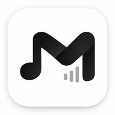
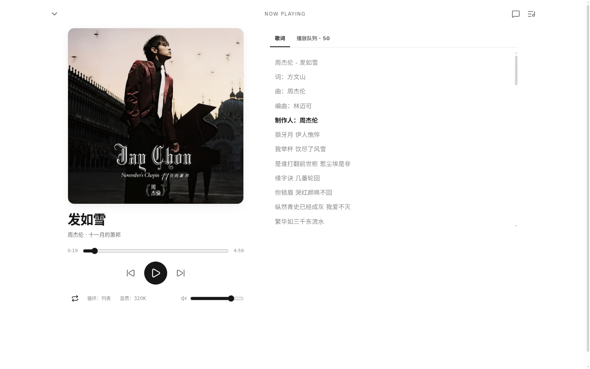
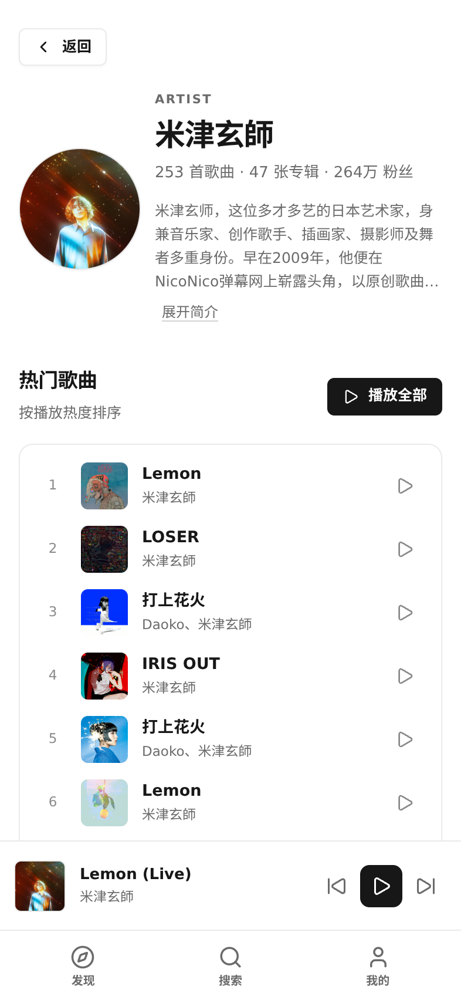

<p align="center">
  
</p>

<h1 align="center">Melos</h1>

<p align="center">
  让 iOS 用户也能免费、便捷地享受音乐。
</p>

<p align="center">
  自托管音乐 PWA · Vue 3 · Docker Compose
</p>

---

## 设计初衷

在 iOS 上使用第三方音乐客户端并不轻松：应用需要上架 App Store，或依赖签名、侧载等有门槛的方式。Melos 把播放器做成 Web PWA，部署在自己的服务器上，用 Safari 打开后「添加到主屏幕」，即可获得接近原生应用的体验。

Melos 本身免费、自托管，不经过应用商店，也不需要单独安装客户端。音乐数据来自第三方接口，具体歌曲能否播放取决于版权与账号权益。


## 核心功能

**播放**

- 128K / 320K / FLAC 三档音质，所选音质不可用时自动降级
- 播放队列、进度拖动、音量与循环模式；队列和进度自动持久化
- 歌曲行「更多」菜单支持下一首播放、添加到播放队列
- Media Session 支持锁屏与系统媒体控制
- 收藏 / 取消收藏，同步到酷狗「我喜欢」

**歌词**

- KRC / LRC 行级同步，支持翻译与音译
- 桌面端固定双栏：封面在左，歌词在右
- 移动端左右滑动切换播放页与歌词页，也可使用右上角歌词按钮
- 歌词在会话内缓存，再次进入不重复加载

**发现与资料库**

- 首页推荐卡片与推荐歌单
- 搜索单曲与歌单，支持实时搜索建议和热搜词
- 歌手页、专辑页、我的歌单与歌单详情
- 播放页的歌手与专辑可点击跳转；合唱歌曲的每位歌手都有独立链接

**评论**

- 查看热门 / 最新评论、楼层回复与评论配图
- 内置图片查看器，可放大、缩小和切换

**移动端与 PWA**

- 可添加到主屏幕，以独立窗口运行，并提供离线壳
- iPhone / iPad 自动连播：预取后续 10 首并预加载下一首音频
- 桌面侧边栏与手机底部导航两套布局

**设置**

- 默认音质、音量、循环模式
- 歌词翻译 / 音译、自动滚动、字号
- 搜索建议、减少动画
- 每日 VIP 奖励领取、账号与队列管理

## 界面预览

<p align="center">
  
</p>

<p align="center"><sub>桌面播放与歌词</sub></p>

<p align="center">
  
  
</p>

<p align="center"><sub>手机播放页 / 歌词页</sub></p>

<p align="center">
  
  
</p>

<p align="center"><sub>歌手页 / 专辑页</sub></p>

## 部署与使用

### 环境要求

- Docker Engine 与 Docker Compose v2
- 一台可以运行容器的 Linux、macOS 或 Windows 主机

### 启动

```bash
git clone -b dev https://github.com/Tomkmonkey/Melos.git
cd Melos
docker compose -f docker-compose.web.yml up -d --build
```

默认映射到宿主机端口 `34962`：

```text
http://<主机IP>:34962
```

首次打开后点击「扫码登录」，使用酷狗音乐概念版 App 扫码并确认。登录态保存在 `melos-web-data` 数据卷，重启或升级容器后仍然有效。

如需更换端口：

```bash
MELOS_WEB_PORT=8080 docker compose -f docker-compose.web.yml up -d --build
```

### 添加到主屏幕

在 iPhone / iPad 上使用 Safari 打开部署地址，点击「分享」中的「添加到主屏幕」。Android 可在浏览器菜单中选择「安装应用」或「添加到主屏幕」。

PWA 安装与 Service Worker 需要 HTTPS（`localhost` 除外）。公网部署请配置反向代理与 TLS 证书。

## 更新

```bash
cd Melos
git pull
docker compose -f docker-compose.web.yml up -d --build
```

`dev` 是当前维护分支，前端源码与预编译产物都在其中。更新时必须带 `--build`，因为 API 与 Web 镜像都可能变化；数据卷不会被删除，升级后无需重新扫码。

## 架构

```text
浏览器 / PWA
     │  HTTP(S) :34962
     ▼
melos-web（Nginx）
     ├── /        → prebuilt/vue
     └── /api/    → melos-api:3005

melos-api（Node.js 18）
     ├── 会话网关 :3005
     │    ├── 登录 / 会话适配
     │    ├── 音频 Range 代理
     │    └── 评论代理
     └── KuGouMusicApi :3006（platform=lite）
```

| 组件 | 说明 |
|---|---|
| `melos-web` | Nginx 与预编译 Vue SPA，默认映射到宿主机端口 `34962` |
| `melos-api` | Node.js 18，包含会话网关与内嵌 KuGouMusicApi |
| `melos-web-data` | 登录会话与网关数据的持久化卷 |

关键设计：

- **会话网关**：客户端只携带 `X-Kg-Session-Id` / `t1` 会话头，由网关映射为酷狗 Cookie；扫码登录、刷新与退出均由网关适配。
- **同源代理**：音频与评论接口多为 HTTP 且不带 CORS 头，统一经 `/api` 转发，并限制目标域名。
- **Range 透传**：音频代理完整转发 `Range` 与 `206` 响应，支持拖动进度。
- **预编译产物**：Vue 前端在构建阶段生成 `prebuilt/vue`，部署机只需要 Docker。

## 技术栈

| 层级 | 技术 |
|---|---|
| 前端 | Vue 3.5、TypeScript 6、Vite 8、Pinia、Vue Router |
| PWA | vite-plugin-pwa、Workbox |
| 界面 | 原生 CSS、lucide-vue-next |
| 音频 | HTML5 Audio、Media Session API |
| 后端 | Node.js 18、Express、自研会话网关 |
| 部署 | Nginx、Docker Compose |

## 项目结构

```text
.
├── docker-compose.web.yml
├── Dockerfile.web.vue
├── Dockerfile.api
├── docker/
│   ├── gateway/server.js
│   ├── nginx-web.conf
│   ├── api/start.sh
│   └── build-vue.sh
├── prebuilt/vue/
├── screenshots/
├── third_party/KuGouMusicApi/
├── vue/
│   ├── src/
│   │   ├── api/
│   │   ├── components/
│   │   ├── stores/
│   │   └── views/
│   └── public/
└── api.json
```

## 开发

前端构建需要 Node.js 20.19+ 或 22.12+。

```bash
cd vue
npm install
npm run dev      # Vite 开发服务器，/api 代理到 127.0.0.1:3005
npm run build    # 产物输出到 ../prebuilt/vue
```

本地调试 API 时，可先启动 Docker 服务：

```bash
docker compose -f docker-compose.web.yml up -d --build
```

修改 `vue/` 代码后必须重新生成 `prebuilt/vue`，否则 Web 镜像不会更新：

```bash
./docker/build-vue.sh
```

## 环境变量

| 变量 | 默认值 | 说明 |
|---|---|---|
| `MELOS_WEB_PORT` | `34962` | Web PWA 的宿主机端口 |
| `TZ` | `Asia/Shanghai` | 容器时区 |
| `KUGOU_API_PROXY` | 空 | KuGouMusicApi 使用的 HTTP 代理 |

前端固定使用同源 `/api`，由 Nginx 转发到会话网关，无需额外配置 API 地址。

## 语言与国际化

- 当前界面仅提供简体中文，仓库尚未接入 i18n 框架或语言资源目录。
- README 只有中文版本，没有其他语言的 README 文件。
- 歌词的翻译与音译来自上游歌词数据，可在设置中开关；它属于内容能力，不是界面国际化。

## 常见问题

**为什么部分歌曲无法播放？**

VIP、版权受限或没有无损源的歌曲可能无法返回播放地址。播放器会按所选音质逐级降级到 320K / 128K；若仍无可用地址，会提示播放失败。

**PWA 无法安装或离线壳不生效？**

PWA 与 Service Worker 需要 HTTPS（`localhost` 除外）。公网部署请为域名配置 TLS。

**升级后浏览器仍是旧界面？**

彻底关闭 PWA 后重新打开，或在浏览器中强制刷新（Ctrl+Shift+R）。升级时请带上 `--build`，确保 `melos-web` 与 `melos-api` 都重新构建。

**登录态会丢失吗？**

不会。会话保存在 `melos-web-data` 数据卷；只有执行 `docker compose -f docker-compose.web.yml down -v` 才会清空。

**端口被占用怎么办？**

使用 `MELOS_WEB_PORT=8080 docker compose -f docker-compose.web.yml up -d --build` 更换端口。

**锁屏或灵动岛可以收藏歌曲吗？**

不能。Web Media Session API 没有收藏动作，PWA 只能在播放页内收藏；锁屏与媒体控制支持播放、暂停、上一首和下一首。

## 更新日志

版本与变更记录见 [vue/CHANGELOG.md](vue/CHANGELOG.md)。

相关文档：

- [部署说明](docker/README.md)
- [前端说明](vue/README.md)

## 声明与许可

| 范围 | 说明 |
|---|---|
| Melos 仓库代码 | 仓库暂未附带根目录 `LICENSE` 文件；再分发或商用前请先取得维护者授权并补充许可证。 |
| KuGouMusicApi | 使用 MIT License，版权归原作者所有；完整声明见 [third_party/KuGouMusicApi/LICENSE](third_party/KuGouMusicApi/LICENSE)。 |
| 音乐内容 | 音乐、封面、歌词、评论等内容的版权归原平台与权利人所有。本项目不存储音乐文件，不提供下载，仅供学习交流。 |

Melos 基于 [KA Music](https://github.com/umr-xiaomai/kgka_Music_hl) 的功能重构，保留原项目署名。Melos 是非官方项目，与酷狗音乐、腾讯音乐娱乐集团无隶属或合作关系。酷狗、KuGou 及相关标识归腾讯音乐娱乐集团及权利方所有。请支持正版音乐。
