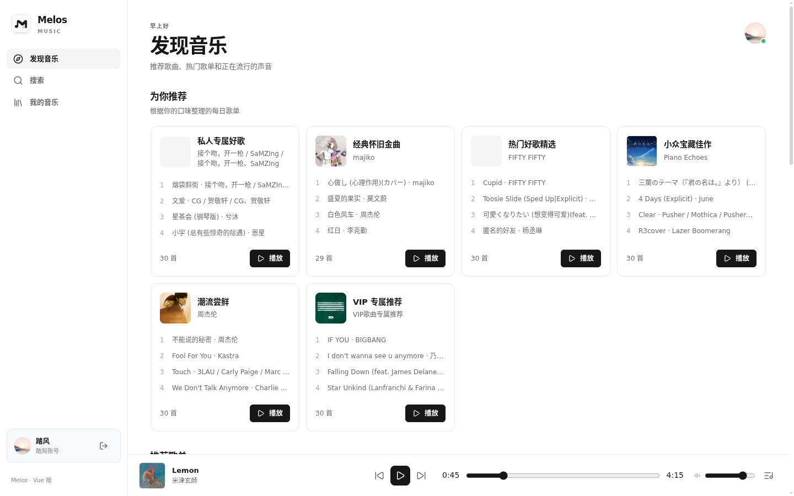
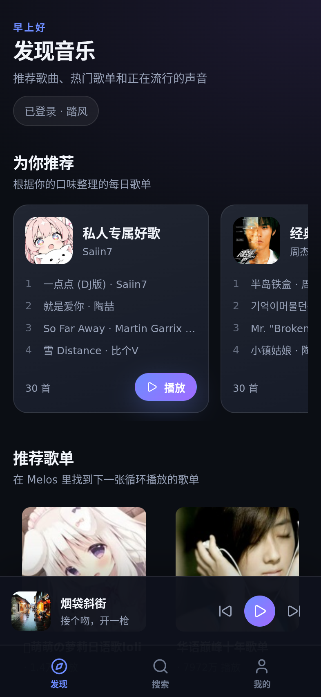
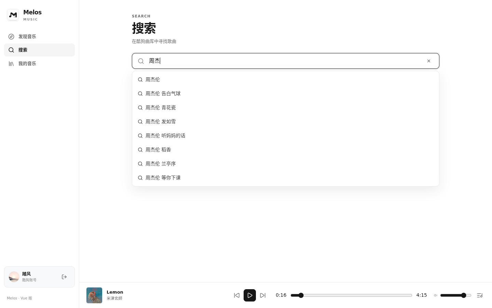
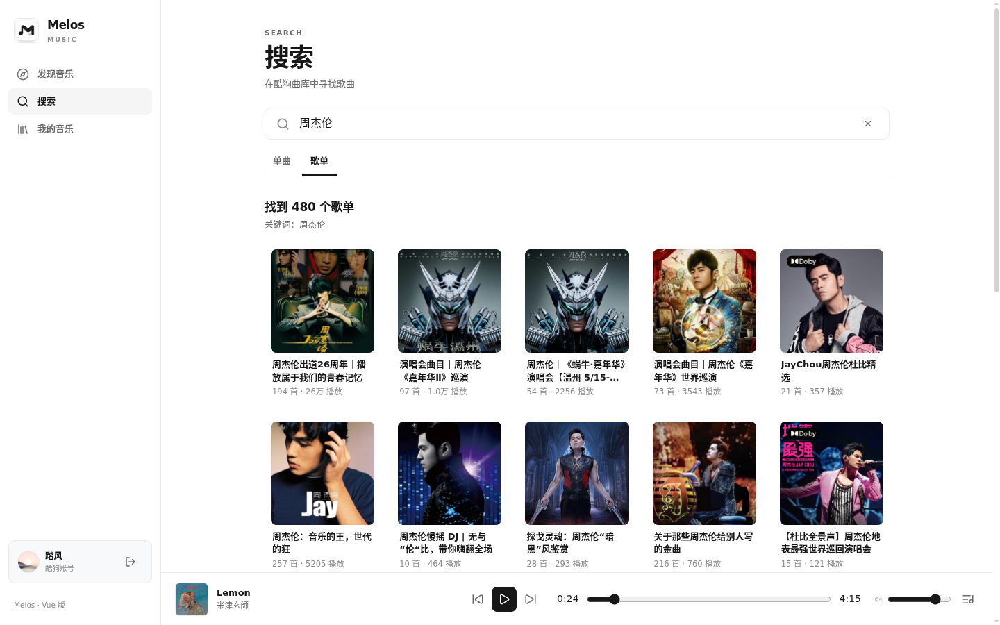
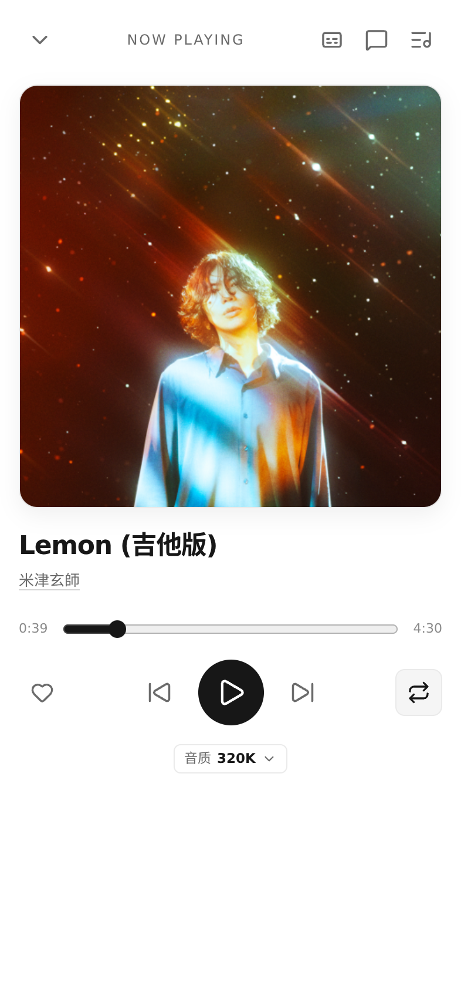
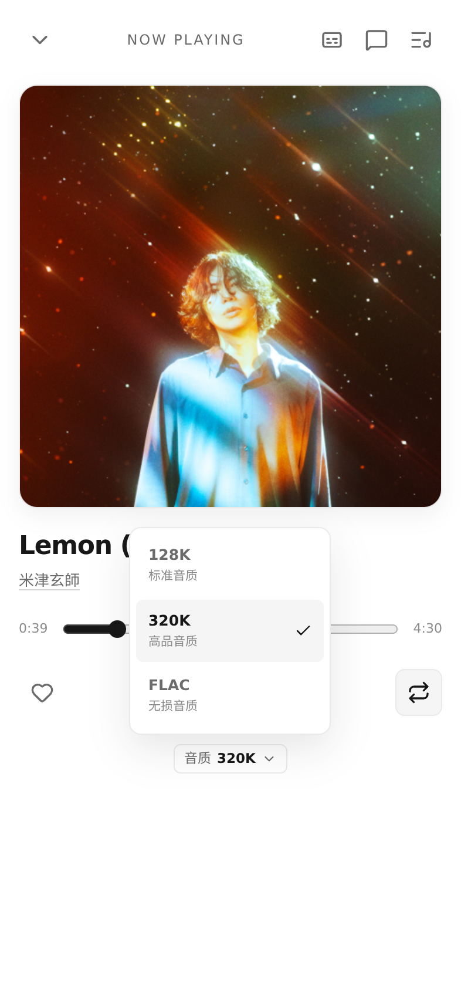
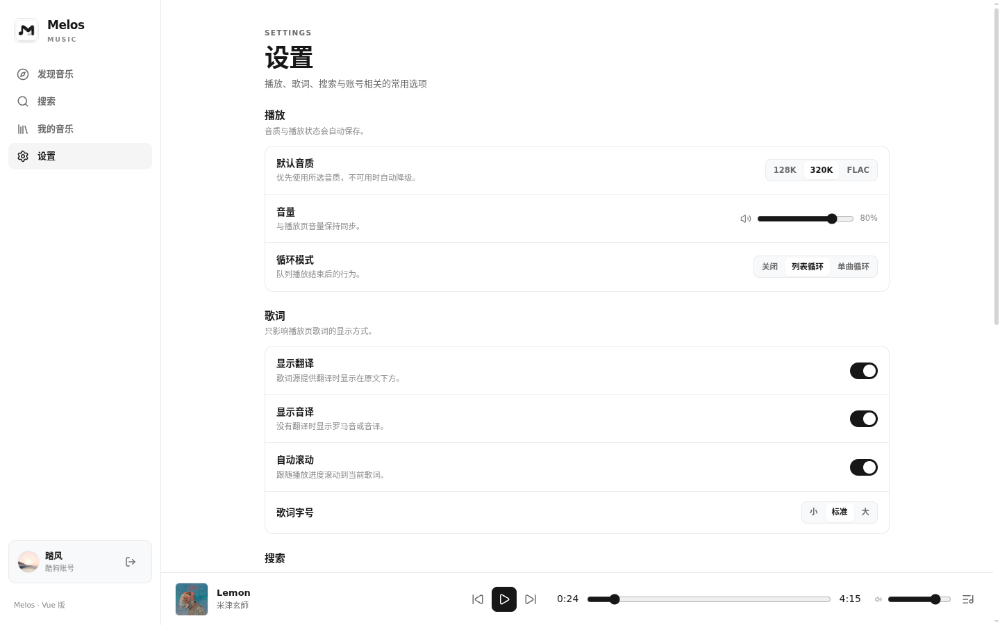
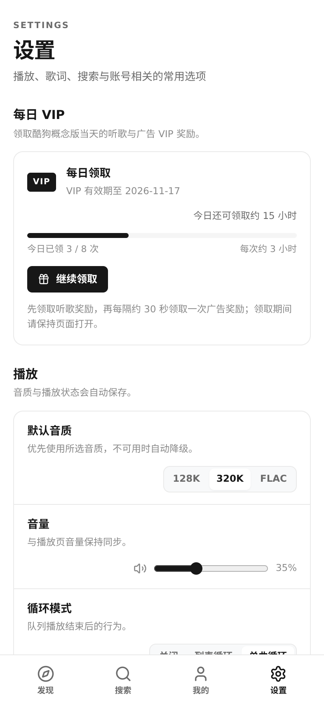
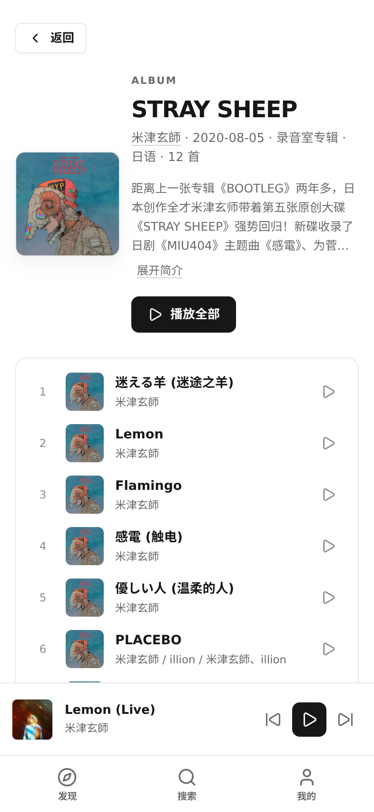
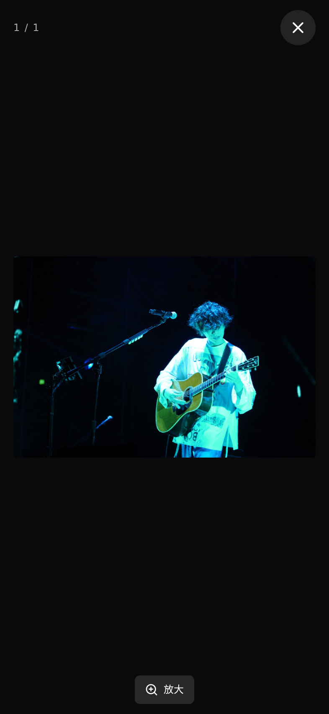

<p align="center">
  
</p>

<h1 align="center">Melos</h1>

<p align="center">
  <strong>自托管音乐 Web PWA · 一条 Docker 命令启动</strong>
  <br />
  Vue 3 前端 · 内嵌 KuGouMusicApi · 扫码登录 · 自适应桌面 / 手机
</p>

<p align="center">
  
  
  
  
  
  
</p>

<p align="center">
  
  
  
</p>

---

## 📖 Melos 是什么

**Melos 是一个自托管的音乐 Web PWA。** 它把 Vue 3 前端、酷狗 API
（KuGouMusicApi）和会话适配网关打包成一套 Docker Compose 服务。

部署后打开浏览器即可使用：用 **酷狗音乐概念版 App** 扫码登录一次，就能搜索、
播放、管理歌单、看歌词和评论；在 iPhone / Android 上「添加到主屏幕」后，
它就像一个原生音乐 App 一样运行。

> 仓库只维护 Vue Web PWA。此前的 Flutter、Linux 桌面与 VNC 版本已移除。

### 为什么是 Melos

- **一条命令部署**：`docker compose -f docker-compose.web.yml up -d --build`。
- **浏览器原生播放**：HTML5 Audio + 同源音频代理，不需要 VNC 或网页桌面。
- **无需前端编译环境**：Vue 产物已预编译到 `prebuilt/vue`，服务器只需要 Docker。
- **纯白极简 UI**：白色背景、浅灰分隔、细边框、黑白按钮，无渐变、
  无玻璃拟态、无装饰光效。
- **登录态持久化**：会话保存在 `melos-web-data` 数据卷，重启 / 升级无需重新扫码。
- **同源代理**：音频、评论、头像都经由 `/api` 转发，避开 HTTPS 混合内容与 CORS。
- **移动端友好**：输入框字号 16px 避免 iOS 聚焦放大；动效克制，
  听歌时页面可以进入空闲状态。

> 本项目通过第三方 API 获取音乐数据，仅供学习交流。歌曲版权归原平台与版权方所有；
> VIP / 版权受限歌曲可能没有可用播放地址。

---

## 🚀 快速开始

### 环境要求

- Docker 24+ 与 Docker Compose v2
- 一台可以运行容器的 Linux / macOS / Windows 主机

### 启动

```bash
git clone -b dev https://github.com/Tomkmonkey/Melos.git
cd Melos
docker compose -f docker-compose.web.yml up -d --build
```

默认使用宿主机端口 **34962**，启动后打开：

```
http://<主机IP>:34962
```

1. 点击「扫码登录」。
2. 使用 **酷狗音乐概念版 App** 扫码并确认。
3. 登录态写入 `melos-web-data` 数据卷，重启容器后仍然有效。

如需更换端口：

```bash
MELOS_WEB_PORT=8080 docker compose -f docker-compose.web.yml up -d --build
```

---

## ✨ 功能

### 🎵 播放

- HTML5 Audio + Media Session（锁屏 / 系统媒体控制）
- **音质选择：128K / 320K / FLAC**，切换时保持当前播放位置
- 320K / 128K 自动降级重试
- 播放队列、上一首 / 下一首、进度拖动、音量、循环模式
- **收藏 / 取消收藏**：同步到酷狗「我喜欢」，播放控件按「收藏 — 播放控件 — 循环模式」排布
- 队列与进度持久化，刷新或重开 PWA 后自动恢复

### 🎤 歌词

- KRC / LRC 行级同步，翻译与音译；LRC 同行翻译合并兜底
- 歌词会话缓存：同一首歌再次进入播放页不重复加载
- 桌面端：封面在左，歌词固定在右侧
- 移动端：向右滑进入歌词，向左滑返回封面；也可点右上角的歌词图标

### 💬 评论

- 热门 / 最新评论、楼层回复、评论配图
- 内置图片查看器：点击评论图片即可放大、缩小、左右切换
- 评论、头像与图片经由同源代理加载，HTTPS 下可用

### 🔍 搜索与发现

- 首页 6 组推荐歌曲 + 推荐歌单
- 搜索单曲与歌单，播放全部
- 实时搜索建议与真实热搜词
- **歌手页 / 专辑页**：播放页的歌手、专辑名称可点击跳转；合唱歌曲的每位歌手均可单独点击
- 我的歌单、歌单详情

### 📱 PWA 与自适应

- **桌面**：左侧导航 + 内容区 + 底部播放条
- **手机**：底部导航 + 迷你播放条 + 全屏播放页
- 发现页右上角头像 + 在线绿点，点击直达「我的音乐」
- 发现 / 搜索 / 歌单页自动缓存，进入播放页再返回不重新加载
- PWA 安装、离线壳、独立窗口运行
- iPhone / iPad PWA 自动连播：提前预取后续 10 首并预加载下一首音频，歌曲结束后直接切换

### ⚙️ 设置

- 账号：登录状态与退出登录（置顶）
- 每日 VIP：听歌奖励 + 广告奖励自动领取，显示今日进度与精确到期时间
  （领取逻辑参考 [develop202/kgcheckin](https://github.com/develop202/kgcheckin)）
- 播放：默认音质、音量、循环模式
- 歌词：翻译 / 音译开关、自动滚动、字号
- 搜索：搜索建议开关、清除最近搜索
- 外观与性能：减少动画
- 数据：清空播放队列、恢复默认设置

---

## 📸 界面预览

| 桌面首页 | 手机首页 |
|:--------:|:--------:|
|  |  |

| 搜索建议（桌面） | 歌单搜索（桌面） |
|:--------:|:--------:|
|  |  |

| 歌词页（桌面） | 手机歌词页 |
|:------:|:--------:|
|  |  |

| 手机播放页 | 音质选择 |
|:----------:|:--------:|
|  |  |

| 设置（桌面） | 设置（手机） |
|:----------:|:--------:|
|  |  |

| 歌手页 | 专辑页 |
|:------:|:------:|
|  |  |

| 评论面板 | 图片查看器 |
|:------:|:------:|
|  |  |

---

## 🏗️ 架构与实现

```
浏览器 / PWA
      │  http(s)://<host>:34962
      ▼
┌───────────────────────────────────────────────┐
│ Docker 项目 melos-web                         │
│                                               │
│  melos-web (Nginx)                           │
│    ├── /            → prebuilt/vue 静态文件   │
│    └── /api/        → melos-api:3005          │
│                                               │
│  melos-api (Node 18)                          │
│    ├── 会话网关 server.js                      │
│    │     ├── /audio-proxy    音频 Range 转发   │
│    │     ├── /comment-proxy  评论转发          │
│    │     └── 登录 / 会话协议适配               │
│    └── KuGouMusicApi :3006 (platform=lite)    │
└───────────────────────────────────────────────┘
```

### 组成

| 组件 | 说明 |
|---|---|
| `melos-web` | Nginx + 预编译 Vue 3 SPA，默认端口 80（宿主机 34962） |
| `melos-api` | Node 18，内置会话网关与 KuGouMusicApi |
| `melos-web-data` | 登录会话、网关数据持久化卷 |
| `prebuilt/vue` | 已构建的 Vue 前端产物，部署时不需要 Node SDK |

### 关键设计

- **会话网关**：客户端只认 `X-Kg-Session-Id` / `t1` 头，网关转换成酷狗 Cookie；
  扫码登录、刷新、退出都由网关适配。
- **同源代理**：音频与评论接口多为 HTTP 且不带 CORS 头；
  `/api/audio-proxy` 与 `/api/comment-proxy` 在服务端转发，并严格限制目标域名。
- **Range 透传**：音频代理完整转发 `Range` / `206`，支持拖动进度。
- **预编译产物**：Vue 前端在开发机编译，部署机只负责打包镜像。
- **音质降级**：所选音质不可用时自动尝试低一级音质，避免播放中断。

---

## 🛠️ 开发与构建

### 环境

- Node.js 20+ / npm
- 可选：Docker 24+ / Compose v2

### 前端开发

```bash
cd vue
npm install
npm run dev      # Vite 开发服务器，/api 代理到 127.0.0.1:3005
npm run build    # 产物输出到 ../prebuilt/vue
```

需要本地 API 时，可先启动 Docker 服务：

```bash
docker compose -f docker-compose.web.yml up -d --build
```

### 重新生成预编译产物

```bash
./docker/build-vue.sh
# 等价于
cd vue && npm ci && npm run build
```

修改 `vue/` 代码后必须重新生成 `prebuilt/vue`，否则 Web 镜像不会更新。

### 环境变量

| 变量 | 说明 | 默认值 |
|---|---|---|
| `MELOS_WEB_PORT` | Web PWA 宿主机端口 | `34962` |
| `TZ` | 容器时区 | `Asia/Shanghai` |
| `KUGOU_API_PROXY` | KuGouMusicApi 的 HTTP 代理 | *(空)* |

前端固定使用同源 `/api`，由 Nginx 转发到会话网关，无需配置 API 地址。

---

## 📁 项目结构

```
docker-compose.web.yml       # Web PWA 一键启动
Dockerfile.web.vue           # Web 镜像：Nginx + prebuilt/vue
Dockerfile.api               # API 镜像：KuGouMusicApi + 会话网关
docker/
├── nginx-web.conf           # 静态资源 + /api 同源反代
├── gateway/server.js        # 会话网关、音频/评论代理
├── api/start.sh             # API 容器启动脚本
└── build-vue.sh             # 重新生成 prebuilt/vue
prebuilt/vue/                # 预编译 Vue Web 产物
third_party/
└── KuGouMusicApi/           # 内嵌酷狗 API
vue/                         # Vue 3 + Vite + TypeScript 前端
├── src/
│   ├── api/                 # HTTP 客户端、解析、歌词、评论、歌手/专辑
│   ├── stores/              # 登录、播放器状态
│   ├── components/          # 播放条、评论面板、图片查看器等
│   └── views/               # 首页、搜索、歌手、专辑、歌单、播放页、设置
├── public/                  # PWA 图标
└── vite.config.ts           # PWA / 构建 / 开发代理
api.json                     # KuGouMusicApi OpenAPI 文档
```

---

## ❓ 常见问题

**评论区一直加载不出来？**
更新到最新版本，并确认 **api 镜像也重新构建**：

```bash
git pull
docker compose -f docker-compose.web.yml up -d --build
```

旧镜像没有 `/api/comment-proxy`，只重启容器不会生效。

**PWA 无法安装 / 离线壳不工作？**
需要 HTTPS（`localhost` 除外）。公网部署请配置反向代理与证书。

**端口被占用？**
使用 `MELOS_WEB_PORT=8080 docker compose -f docker-compose.web.yml up -d --build`。

**升级后浏览器仍是旧界面？**
彻底关闭 PWA 后重新打开，或在浏览器中强制刷新（Ctrl+Shift+R）。

**选择了 FLAC 但感觉没有变化？**
部分歌曲没有无损源，播放器会自动降级到 320K / 128K，避免播放失败。

**歌曲无法播放？**
VIP / 版权受限歌曲可能不返回播放地址；也可能是网络或音质降级后仍无可用源。

**登录态会丢吗？**
不会。会话保存在 `melos-web-data` 数据卷；只有执行 `down -v` 才会清空。

---

## 🔄 更新方式

```bash
cd Melos
git pull
docker compose -f docker-compose.web.yml up -d --build
```

- `dev` 是默认分支，Vue 源码与预编译产物都在这里。
- 必须带 `--build`：API 与前端都可能更新。
- 数据卷不会删除，升级后无需重新扫码。

---

## 📝 更新日志

- 更新记录：[vue/CHANGELOG.md](vue/CHANGELOG.md)
- 部署说明：[docker/README.md](docker/README.md)
- 前端说明：[vue/README.md](vue/README.md)

### 近期更新

- 播放页收藏：一键收藏 / 取消收藏到「我喜欢」，控制区改为「收藏 — 播放控件 — 循环模式」
- 新增设置页：音质、音量、循环模式、歌词显示、搜索、动画、账号与数据管理
- 设置页支持每日领取酷狗概念 VIP
- iPhone / iPad PWA 自动连播优化：预取后续 10 首、预加载下一首音频并避免 iOS 阻止自动播放
- 歌词缓存、合唱多歌手跳转、设置页账号前置、VIP 到期时间按本地时区展示
- 播放页音质选择（128K / 320K / FLAC）
- 评论图片内置查看器
- 搜索页新增歌单搜索
- 新增歌手页与专辑页，播放页歌手 / 专辑可点击跳转
- 移除 Flutter / Linux 桌面 / VNC 版本，只保留 Vue Web PWA
- 纯白极简 UI、响应式布局、PWA 安装与离线壳
- KRC / LRC 行级歌词、翻译与音译
- 搜索建议、真实热搜词、发现页头像与在线状态

---

## 📄 声明

- Melos 基于 [KA Music](https://github.com/umr-xiaomai/kgka_Music_hl) 的功能重构，
  音乐数据来自第三方接口，仅供学习交流。
- 酷狗、KuGou 及相关标识归腾讯音乐娱乐集团及权利方所有。
- 本项目不提供音乐下载，不存储音乐文件；请支持正版音乐。
