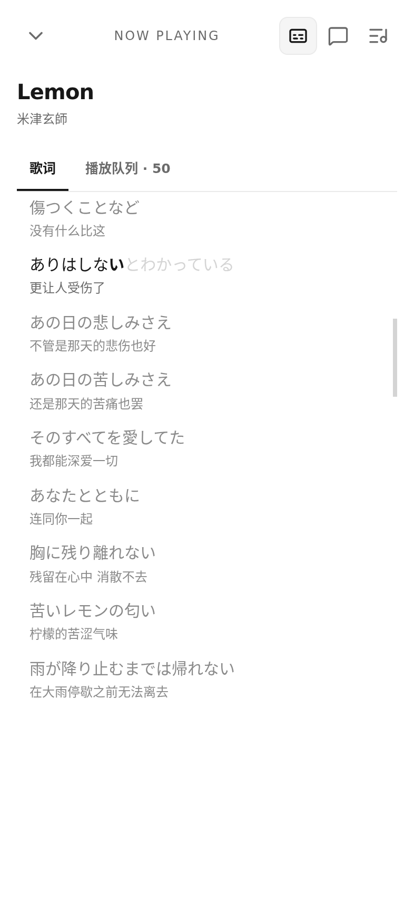
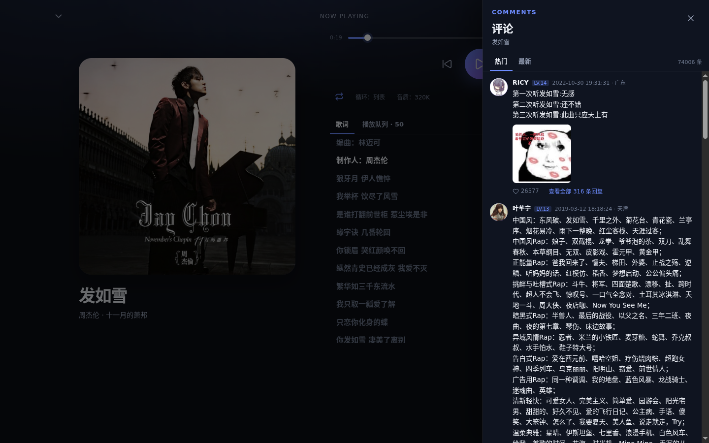

<p align="center">
  
</p>

<h1 align="center">Melos</h1>

<p align="center">
  <strong>自托管音乐 Web PWA · 一条 Docker 命令启动</strong>
  <br />
  Vue 3 前端 · 内嵌 KuGouMusicApi · 扫码登录 · 自适应桌面/手机
</p>

<p align="center">
  
  
  
  
  
  
</p>

<p align="center">
  
  
  
  
</p>

---

## 📖 Melos 是什么

**Melos 是一个自托管的音乐 Web PWA。** 它把 Vue 3 Web 前端、酷狗 API
（KuGouMusicApi）和会话适配网关打包成一套 Docker Compose 服务。
Web 端基于 [KA Music](https://github.com/umr-xiaomai/kgka_Music_hl) 的功能重构；
可选的 Linux 桌面版仍使用 Flutter。

部署后打开浏览器即可使用：用 **酷狗音乐概念版 App** 扫码登录一次，就能搜索、
播放、管理歌单、看歌词和评论；在 iPhone / Android 上「添加到主屏幕」后，
它就像一个原生音乐 App 一样运行。

> **分支说明**：默认分支 `dev` 即 Vue 3 + Vite + TypeScript 版本（源码在 `vue/`），
> `docker-compose.web.yml` 构建 Vue 产物 `prebuilt/vue`。原 `main` 分支已合并到
> `dev` 并移除；Flutter Web 与 Linux 桌面版源码仍保留在仓库历史中，可按需回退。

### 为什么是 Melos

- **一条命令部署**：`docker compose -f docker-compose.web.yml up -d --build`。
- **不需要 VNC**：浏览器原生 HTML5 音频播放，不再通过网页桌面串流声音。
- **不需要 Flutter / Node SDK**：Web 前端已重构为 Vue 3 并预编译到 `prebuilt/vue`，
  服务器构建只做镜像打包。
- **Vue 3 重构版**：响应式布局、DOM 渲染，不再使用 CanvasKit 全屏画布；
  桌面侧栏 + 手机底部导航，天然适配各种屏幕。
- **纯白极简 UI**：白色背景、浅灰分隔、细边框、黑白按钮，无渐变、
  无玻璃拟态、无装饰光效，排版与留白优先。
- **登录态持久化**：会话保存在 `melos-web-data` 数据卷；Vue 版还会自动迁移
  Flutter 版浏览器里的登录态，升级后无需重新扫码。
- **同源代理**：音频、评论、头像都经由 `/api` 转发，避开 HTTPS 混合内容与 CORS。
- **移动端友好**：输入框字号 16px 避免 iOS 聚焦放大；骨架屏与动效保持静态，
  听歌时页面可以真正进入空闲状态。
- **可选桌面版**：需要本地音乐、下载、桌面歌词时，可改用 Linux 桌面版部署。

> 本项目通过第三方 API 获取音乐数据，仅供学习交流。歌曲版权归原平台与版权方所有；
> VIP / 版权受限歌曲可能没有可用播放地址。

---

## 🚀 快速开始

### 环境要求

- Docker 24+，Docker Compose v2
- x86_64 Linux 主机
- 默认占用宿主机端口 **34962**

### 1. 启动

```bash
git clone https://github.com/Tomkmonkey/Melos.git
cd Melos
docker compose -f docker-compose.web.yml up -d --build
```

> 已经拿到本项目目录时，直接进入该目录执行最后一条命令即可。

打开 `http://<主机IP>:34962`。

### 2. 登录

1. 在登录页选择「扫码登录」。
2. 使用 **酷狗音乐概念版 App** 扫码并确认。
3. 登录态写入 `melos-web-data` 数据卷与浏览器 localStorage，下次打开自动恢复。

### 3. 安装为 PWA

- **iPhone / iPad**：Safari 打开 → 分享 → 「添加到主屏幕」。
- **Android**：Chrome 打开 → 菜单 → 「安装应用」/「添加到主屏幕」。
- **桌面浏览器**：Chrome / Edge 地址栏右侧的安装图标。

> 公网部署建议使用 HTTPS：Service Worker 与 PWA 安装要求安全上下文
>（`localhost` 除外）。可用 Caddy / Nginx / 反向代理自行配置证书。

### 常用命令

```bash
# 查看日志
docker compose -f docker-compose.web.yml logs -f

# 停止
docker compose -f docker-compose.web.yml down

# 停止并清空登录态 / 数据（不可恢复）
docker compose -f docker-compose.web.yml down -v

# 更换端口
MELOS_WEB_PORT=8080 docker compose -f docker-compose.web.yml up -d --build
```

---

## ✨ 功能亮点（Vue 重构版）

> dev 分支的 Web 端已迁移到 Vue 3，覆盖核心听歌流程；更完整的 Flutter 功能
> （歌单导入、下载、FM、统计等）仍在 Flutter 源码中，后续逐步迁移。

### 🎵 播放

- HTML5 Audio + Media Session（锁屏 / 系统媒体控制）
- 320K / 128K 自动降级重试
- 播放队列、上一首 / 下一首、进度拖动、音量、循环模式
- 队列与进度持久化，刷新或重开 PWA 后自动恢复

### 🎤 歌词

- LRC 逐行同步、翻译合并、自动滚动
- 桌面端：封面在左，歌词固定在右侧
- 移动端：封面页与歌词页左右滑动切换（也可点击底部「播放 / 歌词」）

### 💬 评论

- 热门 / 最新评论、楼层回复、评论配图
- 评论、头像与图片经由同源代理加载，HTTPS 下可用

### 🔍 搜索与曲库

- 首页 6 组推荐歌曲 + 推荐歌单
- 酷狗搜索、播放全部
- 我的歌单、歌单详情

### 📱 PWA 与自适应

- **桌面**：左侧导航 + 内容区 + 底部播放条
- **手机**：底部导航 + 迷你播放条 + 全屏播放页
- PWA 安装、离线壳、独立窗口运行
- 自动迁移 Flutter 版登录态，升级后无需重新扫码

### 🚧 后续迁移

歌单导入、收藏 / 云盘 / 专辑 / FM、设置与主题、播放统计、评论发布、
网易云搜索等功能仍在 Flutter 客户端，后续逐步迁移到 Vue。

---

## 📸 界面预览（Vue 重构版）

| 桌面首页 | 手机首页 |
|:--------:|:--------:|
|  |  |

| 歌词页（桌面） | 手机歌词页 |
|:------:|:--------:|
|  |  |

| 手机播放页 | 评论面板 |
|:----------:|:--------:|
|  |  |

> Flutter 版界面截图仍保留在 `screenshots/home.jpg` 等文件中，可在仓库历史中查看。

---

## 🏗️ 架构与实现

```
浏览器 / PWA
      │  http(s)://<host>:34962
      ▼
┌───────────────────────────────────────────────────┐
│ Docker 项目 melos-web                             │
│                                                   │
│  melos-web (Nginx)                               │
│    ├── /            → prebuilt/vue 静态文件       │
│    └── /api/        → melos-api:3005              │
│                                                   │
│  melos-api (Node 18)                              │
│    ├── 会话网关 server.js                          │
│    │     ├── /audio-proxy    音频 Range 转发       │
│    │     ├── /comment-proxy  评论转发              │
│    │     └── 登录 / 会话协议适配                   │
│    └── KuGouMusicApi :3006 (platform=lite)        │
└───────────────────────────────────────────────────┘
```

### 组成

| 组件 | 说明 |
|---|---|
| `melos-web` | Nginx + 预编译 Vue 3 SPA，默认端口 80（宿主机 34962） |
| `melos-api` | Node 18，内置会话网关与 KuGouMusicApi |
| `melos-web-data` | 登录会话、网关数据持久化卷 |
| `prebuilt/vue` | 已构建的 Vue 前端产物，部署时不需要 Node/Flutter SDK |

### 关键设计

- **会话网关**：客户端只认 `X-Kg-Session-Id` / `t1` 头，网关转换成酷狗 Cookie；
  扫码登录、刷新、退出都由网关适配。
- **同源代理**：音频与评论接口多为 HTTP 且不带 CORS 头，直接请求会被浏览器拦截；
  `/api/audio-proxy` 与 `/api/comment-proxy` 在服务端转发，并严格限制目标域名。
- **Range 透传**：音频代理完整转发 `Range` / `206`，支持拖动进度。
- **预编译产物**：Vue Web 与 Linux 前端都在开发机编译，部署机只负责打包镜像。
- **原生音频**：Vue 版使用浏览器 HTML5 Audio，不再依赖 `just_audio_web`；
  Flutter 版的切歌补丁仍保留在 `third_party/just_audio_web`。

---

## 📱 Web 端实现（Vue）

- **框架**：Vue 3 + Vite + TypeScript + Pinia + Vue Router；原生 DOM 渲染，
  不再使用 CanvasKit，因此不需要限制 DPR。
- **自适应布局**：
  - 桌面：左侧导航 + 内容区 + 底部播放条；
  - 手机：底部导航 + 迷你播放条 + 全屏播放页；
  - 使用 CSS Grid/Flex 与安全区适配，无固定宽度依赖。
- **音频**：HTML5 Audio + `/api/audio-proxy`（Range / 206），支持拖动进度；
  使用 Media Session 接入锁屏与系统媒体控制。
- **歌词**：`/search/lyric` + `/lyric`，LRC 行级同步、翻译合并、自动滚动。
- **评论**：`/api/comment-proxy` 转发热门 / 最新与楼层回复，评论图片走音频代理。
- **登录态迁移**：启动时读取 Flutter 版留下的 `flutter.ka_music_*` localStorage，
  自动恢复登录，无需重新扫码。
- **PWA**：`vite-plugin-pwa` 生成 manifest 与 Service Worker，支持安装与离线壳。
- **移动端细节**：输入框固定 16px，避免 iOS 聚焦放大；不使用实时背景模糊与
  无限动画，听歌时页面可进入空闲状态。

> Flutter 版的 CanvasKit 降级、跑马灯/骨架屏静态化等优化仍保留在 Flutter
> 源码中，供历史版本或桌面版使用。

---

## 🖥️ 可选：Linux 桌面版（KasmVNC）

需要 **本地音乐、下载管理、桌面歌词** 等完整桌面能力时，可使用桌面版。
应用运行在容器内的 KasmVNC 网页桌面中，浏览器打开即可看到图形界面。

```bash
docker compose up -d --build
```

默认地址同样是 `http://<主机IP>:34962`。

1. 在网页桌面里用酷狗概念版 App 扫码登录。
2. 点击网页顶部 Kclient 工具栏的喇叭图标开启网页声音（浏览器要求一次点击）。
3. 登录态、设置与缓存保存在 `ka-music-config` 数据卷。

> 默认镜像使用 `prebuilt/linux-x64`，部署时不会下载 Flutter SDK。
> 端口、访问密码、API 代理等配置见 [docker/README.md](docker/README.md)。

---

## 🛠️ 开发与构建

### 环境

- **Vue Web**：Node.js 20+ / npm
- **Flutter 桌面版 / 历史源码**：Flutter 3.50+（Dart 3.14+）
- 可选：Docker 24+ / Compose v2（构建镜像时）

### Vue 前端开发

```bash
cd vue
npm install
npm run dev      # Vite 开发服务器，/api 代理到 127.0.0.1:3005
npm run build    # 产物输出到 ../prebuilt/vue
```

也可以直接使用 Docker：

```bash
docker compose -f docker-compose.web.yml up -d --build
```

### Flutter 桌面版开发

```bash
flutter pub get
flutter run -d linux
```

> 项目通过 `dependency_overrides` 使用 `third_party/just_audio_web`，
> `flutter pub get` 会自动解析。该补丁用于 Flutter Web，不影响 Vue 版。

### 重新生成预编译产物

```bash
# 重新构建 Vue 前端 → prebuilt/vue
./docker/build-vue.sh

# 重新构建 Linux 桌面版 → prebuilt/linux-x64
./docker/build-linux.sh

# 重新构建并启动 Web 镜像
docker compose -f docker-compose.web.yml up -d --build
```

如果需要在 Docker 内从源码编译：

- Vue：直接修改 `Dockerfile.web.vue` / 使用 `prebuilt/vue`
- Flutter Web（历史版本 / 回退）：`Dockerfile.web.source`
- 桌面版：`Dockerfile.source`

### 环境变量

| 变量 | 说明 | 默认值 |
|---|---|---|
| `MELOS_WEB_PORT` | Web PWA 宿主机端口 | `34962` |
| `TZ` | 容器时区 | `Asia/Shanghai` |
| `KUGOU_API_PROXY` | KuGouMusicApi 的 HTTP 代理 | *(空)* |
| `KA_MUSIC_API_BASE_URL` | Flutter 版默认 API 地址 | `https://music.api.hoilai.cn` |
| `KA_MUSIC_DEBUG_LYRICS` | Flutter 版歌词调试日志 | `true` |

Vue 版固定使用同源 `/api`，由 Nginx 转发到会话网关，无需配置 API 地址。

### 测试

```bash
flutter test test/local_lyrics_test.dart
flutter test test/playlist_import_test.dart
```

覆盖 Flutter 版的 LRC 编码、内嵌歌词、联网匹配与缓存，以及歌单导入流程。
Vue 版的自动化测试尚未接入。

---

## 📁 项目结构

```
docker-compose.web.yml       # Web PWA 一键启动（dev 默认 Vue）
Dockerfile.web.vue           # Web 镜像：Nginx + prebuilt/vue
Dockerfile.api               # API 镜像：KuGouMusicApi + 会话网关
vue/                         # Vue 3 + Vite + TypeScript 前端
├── src/
│   ├── api/                 # HTTP 客户端、解析、歌词、评论
│   ├── stores/              # 登录、播放器状态
│   ├── components/          # 播放条、评论面板、歌曲列表等
│   └── views/               # 首页、搜索、我的、歌单、播放页、登录
├── public/                  # PWA 图标
└── vite.config.ts           # PWA / 构建 / 开发代理
prebuilt/vue/                # 预编译 Vue Web（dev 默认部署产物）
docker/
├── nginx-web.conf           # 静态资源 + /api 同源反代
├── gateway/server.js        # 会话网关、音频/评论代理
├── build-vue.sh             # 重新生成 prebuilt/vue
└── build-linux.sh           # 重新生成 prebuilt/linux-x64
prebuilt/web/                # Flutter Web（历史版本 / 回退用）
Dockerfile.web               # Flutter Web 镜像（历史版本 / 回退）
Dockerfile.web.source        # Flutter Web 源码构建（legacy）
web/                         # Flutter PWA shell、manifest、图标
lib/                         # Flutter 应用源码（桌面版 / 历史版本）
third_party/
├── KuGouMusicApi/           # 内嵌酷狗 API
└── just_audio_web/          # Flutter Web 切歌修复补丁
Dockerfile / docker-compose.yml   # 可选 Linux 桌面版
```

---

## ❓ 常见问题

**评论区一直加载不出来？**
更新到最新版本，并确认 **api 镜像也重新构建**：

```bash
git pull origin dev
docker compose -f docker-compose.web.yml up -d --build
```

旧镜像没有 `/api/comment-proxy`，只重启容器不会生效。

**PWA 无法安装 / 离线壳不工作？**
需要 HTTPS（`localhost` 除外）。公网部署请配置反向代理与证书。

**端口被占用？**
使用 `MELOS_WEB_PORT=8080 docker compose -f docker-compose.web.yml up -d --build`。

**升级后浏览器仍是旧界面？**
彻底关闭 PWA 后重新打开，或在浏览器中强制刷新（Ctrl+Shift+R）。

**歌曲无法播放？**
VIP / 版权受限歌曲可能不返回播放地址；也可能是网络或音质降级后仍无可用源。

**登录态会丢吗？**
不会。会话保存在 `melos-web-data` 数据卷；只有执行 `down -v` 才会清空。

**从 Flutter 版升级到 Vue 版需要重新扫码吗？**
不需要。Vue 版启动时会读取浏览器 localStorage 里的 `flutter.ka_music_*`
登录态并自动迁移；如果浏览器数据已被清除，扫码一次即可。

**Vue 版为什么比 Flutter 版少了些功能？**
dev 分支优先完成 Web 核心听歌体验（播放、歌词、评论、歌单）；歌单导入、
收藏/云盘/专辑/FM、设置、统计等功能仍在 Flutter 版，后续逐步迁移。
功能清单见 [vue/README.md](vue/README.md)。

---

## 🔄 更新方式

```bash
cd Melos
git pull
docker compose -f docker-compose.web.yml up -d --build
```

- `dev` 是默认分支，Vue 版代码与预编译产物都在这里。
- 如果本地还停在已删除的 `main` 分支：先执行
  `git fetch --prune && git switch dev`。
- 必须带 `--build`：API 与前端都可能更新。
- 数据卷不会删除，升级后无需重新扫码。
- 桌面版更新：`docker compose up -d --build`。

---

## 📝 更新日志

Flutter 应用功能更新见 [update.md](update.md)（当前 Flutter 版本 3.3.0）；
Vue 前端在默认 `dev` 分支迭代。

Melos 部署层近期更新：

- **Web 前端重构为 Vue 3 + Vite**（dev 分支）：响应式布局、HTML5 Audio、
  歌词与评论、PWA、Flutter 登录态迁移
- 新增 Web PWA 部署：Nginx + Node 网关 + 同源 API/音频代理
- 修复 Web 歌单切歌后仍播放同一首（内置 `just_audio_web` 补丁）
- 修复 Web 评论区无法加载（新增 `/api/comment-proxy`）
- 修复扫码登录约 2 分钟延迟（登录接口绕过 API 缓存）
- iPhone 输入框聚焦放大与 PWA 卡顿/发热优化

---

## 📄 声明

- Melos 基于 [KA Music](https://github.com/umr-xiaomai/kgka_Music_hl) 构建，音乐数据来自
  酷狗官方接口（[KuGouMusicApi](https://github.com/MakcRe/KuGouMusicApi)）。
- 本项目仅供学习交流，请勿用于商业用途；请支持正版音乐。
- 与酷狗音乐及其关联公司无任何隶属关系。

---

<p align="center">
  <sub>Melos · 在你的浏览器里，听自己的歌单</sub>
</p>
